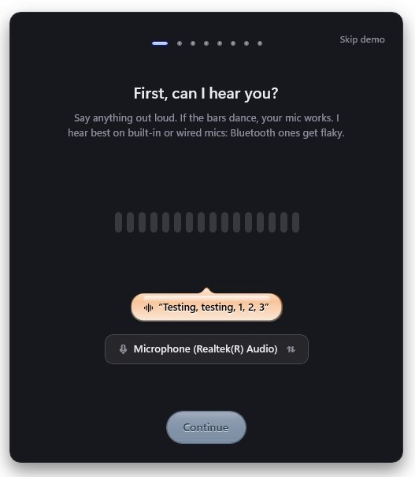
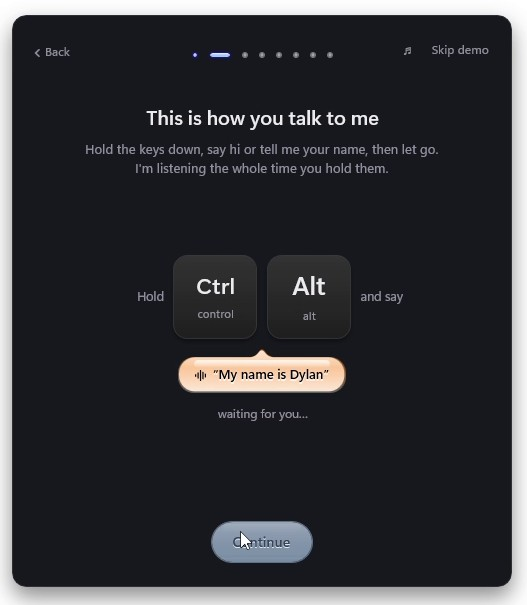
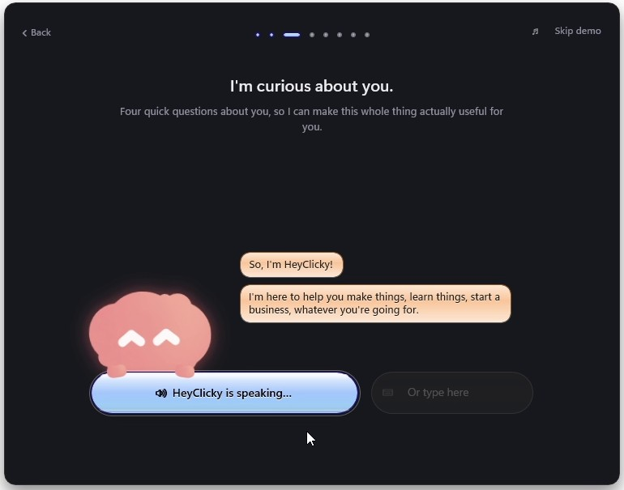
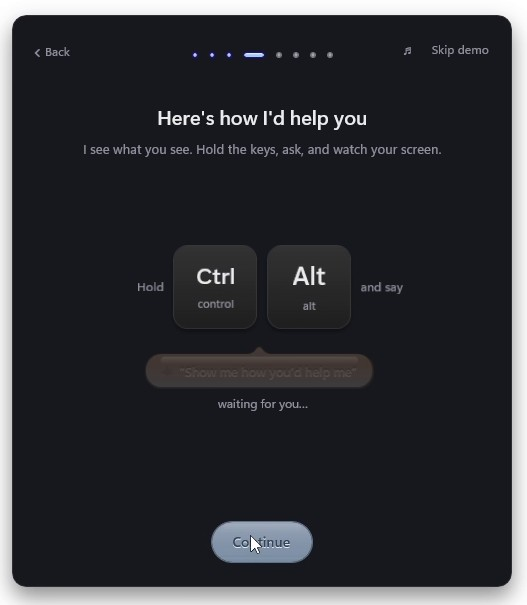
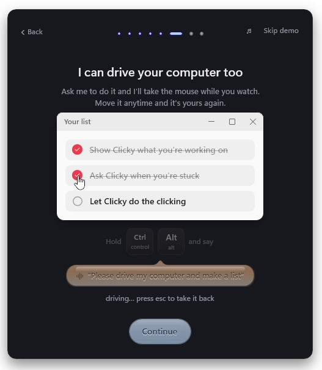
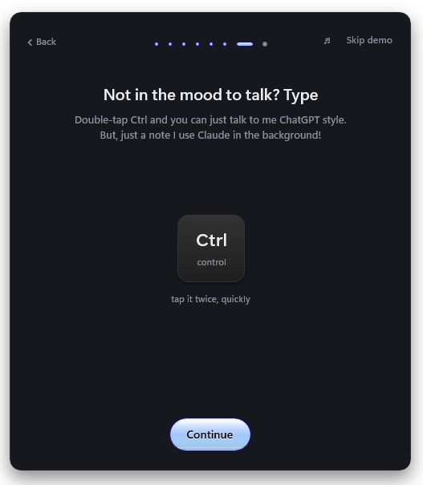
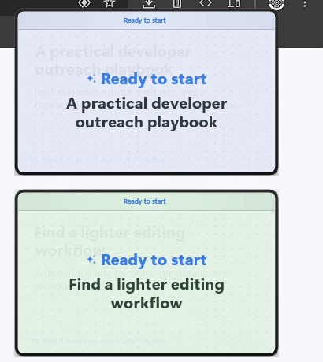
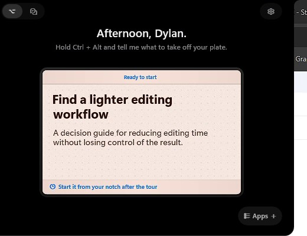

# HeyClicky's onboarding, and what HeyTora takes from it

From a 6-minute screen recording of HeyClicky's whole onboarding on Windows
(heyclickyonboarding.mp4, 29 Oct 2026). Frames are in
`docs/ui/heyclicky/onboarding/`. The rules for our own onboarding stay in
[DESIGN.md](DESIGN.md) §10; this document is the reference for changing it.

**What makes theirs feel real:** almost every step is the product working,
not a description of it. It hears you, then learns your name from what you
said. It interviews you out loud and remembers the answers. It answers a
real question about your screen, drives your mouse to fill in a list, and
ends by handing you jobs it has already prepared from what you told it. The
text on each screen is short, and the voice does the talking.

---

## Their flow, step by step

Every step is the same dark panel in the middle of the screen. Across the
top are **Back**, step dots, a ♪ sound switch and **Skip demo**. Under that
come a title, one or two grey lines, the live thing, and **Continue**, which
stays greyed out until the step is done. The notch at the top of the screen
shows the state all the way through, with a coloured glow that moves:
**Thinking** (purple), **Speaking** (orange) and **Listening** (teal).

| # | Their screen | What happens | Frame |
|---|---|---|---|
| 0 | The notch: "Okay, let me show you around · I'm sorry my CEO yaps so much · ▶ Show me" | It starts from the notch, in its own voice and with a joke | `00` |
| 1 | **First, can I hear you?** | Bars that move with your voice (they turn red as it hears you). A hint bubble: "Testing, testing, 1, 2, 3". The microphone as a chip you can change. Continue lights up once it has heard you | `01` |
| 2 | **This is how you talk to me** | Big Ctrl / Alt keycaps that light up while held, and "and say 'My name is Dylan'". You say your name and it uses it from then on | `02` |
| 3 | **I'm curious about you.** "Four quick questions about you" | A **spoken interview** with their mascot. Its lines appear as chat bubbles while it speaks. A big status button shows "HeyClicky is speaking…", "Thinking…", "Got it…". You answer by holding the keys, or in an **"Or type here"** box with a mic button. It asks what you work on, your story, what you hope it brings, and whether you've used an AI agent. It reflects each answer back ("So you're juggling code and running a business"), then sums up and thanks you by name | `03`–`06` |
| 4 | **Here's how I'd help you** "I see what you see. Hold the keys, ask, and watch your screen." | A suggested question, **made from your interview**. You ask it for real; the panel steps aside while it answers out loud about your actual screen (the notch says Speaking for almost a minute) | `07` |
| 5 | **Circle anything, ask about it** | A looping **video** showing it done. Under it: Hold Ctrl + Alt and ✎ "highlight anything, then ask". Listening / thinking / speaking shows under the keys as you try it | `08` |
| 6 | **I can drive your computer too** "Ask me to do it and I'll take the mouse while you watch. Move it anytime and it's yours again." | A small **"Your list" window** inside the panel. You say "Please drive my computer and make a list", and it types three items and ticks two off ("driving… press esc to take it back") | `09`, `10` |
| 7 | **Not in the mood to talk? Type** | A Ctrl keycap: "tap it twice, quickly". You type, and the reply comes back in the notch ("Hi Dylan! Your message came through loud and clear") | `11`, `13` |
| 8 | **There's one more thing…** | Their red cursor, big, and **Show me**. It talks while it makes **jobs from your interview**. "Ready to start" cards fly to the top right of the screen ("A practical developer outreach playbook", "Find a lighter editing workflow"), then land on the notch's Home ("Start it from your notch after the tour") | `12`, `14`, `15` |
| 9 | **Plans** | The plan card over everything: Free / Pro / Max | `16` |
| — | Home | "Afternoon, Dylan." The newest ready job, with the job cards beside the notch | `15` |

 

  

 

---

## Ours today (DESIGN.md §10), next to theirs

| Ours | Theirs | Note |
|---|---|---|
| Sign in | (before the recording) | Stays |
| Welcome: the website's five scenes, moving | 0: the notch, "let me show you around" | Theirs starts from the product itself |
| What you do: name field, work chips, skill cards | 2 (your name, said out loud) and 3 (spoken interview) | Theirs asks the same things, by voice, and uses them |
| Privacy: skip private windows | – | Ours is a real control; it stays |
| Test your microphone | 1 | Same idea; theirs is calmer and lights up as you talk |
| Test your shortcut | 2 | Theirs combines it with learning your name |
| Ask Tora about this (the equation) | 4 | Theirs uses the person's own screen and a question made from the interview |
| Nice job (what we measured) | – | |
| Pick her voice | – | Ours; it could stay |
| Make her yours: colour, start with Windows | – | Could move to after onboarding |
| You're set | 8 + 9: prepared jobs, then Plans | Theirs ends with something to do |
| – | 5: circle anything | We have pointing and tracing, but no step for it |
| – | 6: drive your computer | We have "take over and do it", but no step for it |
| – | 7: Ctrl Ctrl to type | Built today, but no step for it |

---

## A proposal

The same story as theirs, told by Tora, in our design: the onboarding
panel grows out of the pill like the shape does, in our colours, light or
dark.

1. **Sign in** (as now).
2. **The pill speaks:** "Let me show you around" and ▶ Show me.
3. **First, can I hear you?** Our mic test, restyled: bars in our blue,
   the hint bubble, the mic as a chip.
4. **This is how you talk to me:** hold Ctrl + Win and say your name.
   This replaces both the name field and the separate shortcut test.
5. **I'm curious about you:** a short spoken interview, with Tora's own
   cursor character as the face. The answers fill her memory and pick the
   starter skills (they replace the work chips).
6. **Here's how I'd help you:** a question made from the interview, asked
   about their real screen (this replaces the equation).
7. **Circle anything, ask about it:** tracing while asking, tried for real.
8. **I can drive your computer too:** our own small list window that she
   fills in under "take over and do it", with Esc to stop.
9. **Not in the mood to talk? Type:** Ctrl, Ctrl.
10. **One more thing:** jobs prepared from the interview, as "Ready to
    start" cards landing on Home.
11. **Pick her voice**, then **Plans**, then Home.

Privacy stays (between 3 and 4 or after 9), and "Make her yours" moves to
Settings.

## Decided (29 Oct 2026)

- **Onboarding is free.** Its voice turns use an uncounted "onboarding"
  pass on the server (a migration and a function change, built and tested
  against the local Supabase, released with the app). Without it, a spoken
  interview could use much of a Free plan's 50 credits.
- **No face.** HeyClicky has a mascot; HeyTora has no character, and
  that's fine for now. Her cursor is not dressed up as one (the owner, 29
  Oct 2026, changing the earlier choice). The interview is her voice and
  her lines as chat bubbles.
- **Of ours, only "Pick her voice" stays.** The welcome scenes, the
  privacy step (Skip private windows stays on by default, in Settings →
  Privacy) and the "Nice job" screen go.
- **Circle anything is a live demo:** Tora's cursor traces on the panel
  and she asks about it, then they try it. Nothing to film.

## Tried by the owner (29 Oct 2026)

- **"Can we please skip"** in the interview: she asked on, then it hung on Listening. Now
  skipping always wins (her skip_interview tool, the words heard by the step itself, and a
  Skip these questions link), and the voice can't hang: a closed session reopens on the next
  hold, and no answer in 15 s is their turn again.
- **Circle:** the panel vanished while they circled, and circling without a word got no answer.
- **Drive:** after they took the mouse back, asking again did nothing.
- **Pick her voice** was the preview's empty stand-in: built now (the Settings voice tiles, the
  bundled hello on a tap). **Driving** is slower (an 800 ms glide, typing at 75 ms a key, a
  pause between moves). **"Drive my computer and press Continue"** did nothing - the tour's
  voice had no way to press anything. She now has press_continue: the mouse glides to
  Continue and presses it, or, when the step isn't done, she says what is left. That button
  is all she can press in the tour; the real "do it for me" is the agents', after it.

## Build order

Each phase is usable on its own; the old onboarding stays until the last.

| Phase | What |
|---|---|
| A | **Built.** The frame (`ui/onboarding_shape.py`): the panel grows out of the pill like the shape does, to the middle of the screen; narrow (480) or wide (720) steps; Back, step dots, a sound switch, Skip; Continue lit only when the step is proven; the wizard's `completed` / `ready` / `attach`. `python -m ui.onboarding_shape` shows it with stand-in steps. The pill's glow (`tokens.STATE_GLOW`, `FlowBar.glow`): violet thinking, amber speaking, teal listening, following the voice |
| B | **Built** (`ui/onboarding_steps.py`). **Hi, I'm Tora**: her hello played from the bundled clip (no talk message), Show me - no character on screen. **First, can I hear you?**: bars that rise with the voice, the "Testing, testing" bubble, the microphone as a chip that lists the others; proven by half a second of speech. **This is how you talk to me**: the user's own keys as keycaps that light while held, "Hi Tora!"; proven by a real hold and release; the shortcut borrowed from the running app while the step is up. Hearing the name waits for phase C (it needs the free pass) |
| C | **Built.** **The free onboarding pass**: migration 0014 adds an "onboarding" window - never a talk message, never on the credits, three per account ever, 20 minutes and six passes each, no ticket; the function's voice-pass takes `{onboarding: true}` and says `onboarding_used` after three. The app asks for it only from the tour's own voice (`account.service.TOUR_VOICE`), so the app's standby voice beside it is counted as usual; a server without 0014 simply gives a normal pass. Tried on the local Supabase: three tours then refused, six passes a window, nothing in usage_costs, talk unchanged. **The tour's voice** (`ui/onboarding_interview.py`): one live session for the talk step and the interview, with only two tools - `heard_name` and `interview_done` - so what she learns comes back structured. **This is how you talk to me** now hears the name ("Hi Tora, I'm …") and she says hello by it; the hold alone still proves the step offline. **I'm curious about you** (wide): four questions out loud, her lines and yours as chat bubbles, a status line, answer by holding the keys or typing; the answers become the profile (name, work), the starter skills for that work, and facts in her memory. No voice: it says so and lets them carry on |
| D | **Built**, all on the tour's free voice (no talk messages). **Here's how I'd help you**: a question from the interview's work (the old first launch's TRY list); hold the keys and ask - the panel stays where it is but is left out of the picture she is handed (`keep_out_of_pictures`, Windows' WDA_EXCLUDEFROMCAPTURE; the owner, 29 Oct: hiding it was in the way). Circling or asking without a word still gets an answer (`QUIET_ASK`). **Circle anything**: a looping demo of her circling a figure, then they try it - the line they draw is on the screen as they draw (`TrailOverlay`, click-through) and stays until she has answered, and is on the picture she gets. **I can drive your computer too**: "Your list" in the panel; she picks the items (`make_list`), the step moves the real mouse there, types them and ticks two; Esc or moving the mouse gives it back at once, and asking again starts a fresh list - if she answers without calling make_list, it drives anyway (29 Oct: the second ask did nothing); "Or just let her do it" asks without talking; offline she still drives a plain list. **Not in the mood to talk? Type**: Ctrl, Ctrl opens a box, her answer comes back under it; the app's own Ctrl Ctrl is borrowed while the step is up (`claim_type_tap`) |
| E | One more thing: jobs from the interview as "Ready to start" cards on Home · Pick her voice · Plans · the old onboarding removed |
