# HeyClicky: what we're taking for the HeyTora revamp

Taken from a 90-second screen recording of HeyClicky 1.1.3 on Windows
(28 Oct 2026). HeyClicky is the closest product to ours, and its pages are
clearer than ours. This document is the reference for the revamp. Every
image is in `docs/ui/heyclicky/`. The email on their Account page is
blurred.

**What we copy:** how the app is put together: where it lives on screen,
how it opens, how the pages are split, the navigation, the buttons, the
tabs, the spacing, and what information each page shows.
**What we don't copy:** their name, their mascot, their sample content
("Shippy", "Research Buddy"), their wording, and their prices. Every page
gets HeyTora's own words and our own plans (Free / Pro / Max with credits).

---

## 1. The big idea: one app that grows out of the top of the screen

HeyClicky has no separate app window. Everything lives in one black shape
pinned to the top-centre of the screen, which grows to the size each job
needs:

| Size | What it is | Picture |
|---|---|---|
| **Closed** | A small pill at the top-centre. It glows green while a job is working. | `02-notch-closed.png` |
| **Open** | About 510 × 400. Two tabs at the top left (Home, Chat), **Upgrade** and a **gear** at the top right. | `03-notch-home.png`, `04-notch-chat.png` |
| **Settings** | The same shape grows to about 800 × 650, with a sidebar of settings pages. | `10-…` to `25-…` |
| **Plans** | A card over the top of it: Free, Pro, Max side by side. | `05-plans.png` |

It opens in about a quarter of a second. The black shape grows down and
out from the pill (0–150 ms), then the content fades in and settles
(100–250 ms). No window appears, there's no title bar, and nothing jumps.
That's the "smooth" feel. Frames 50 ms apart:

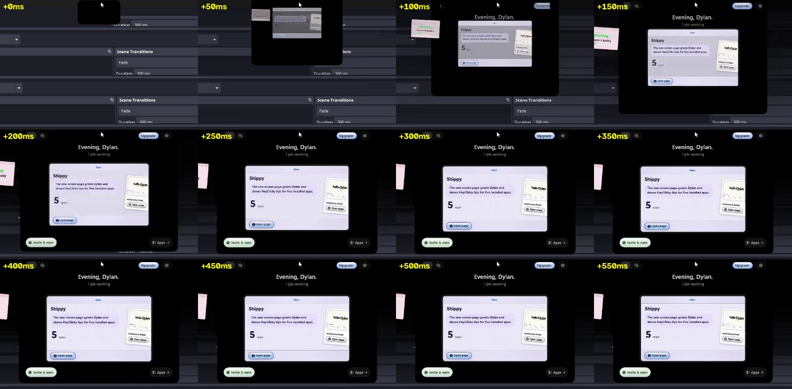

**Ours today:** a tray icon, a full app window with a sidebar (Home, Tora,
Insights, Agents), a *separate* Settings window with ten tabs, a separate
referral window, a floating panel, and a pill (`ui/flow_bar.py`). That's
five different kinds of window to learn. HeyClicky has one.

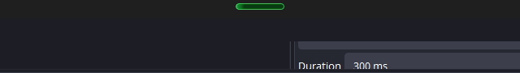

---

## 2. Open: Home and Chat

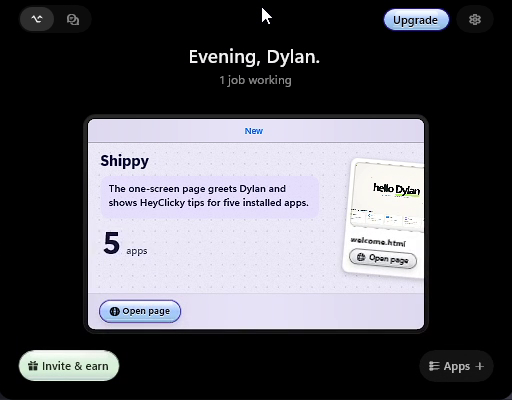 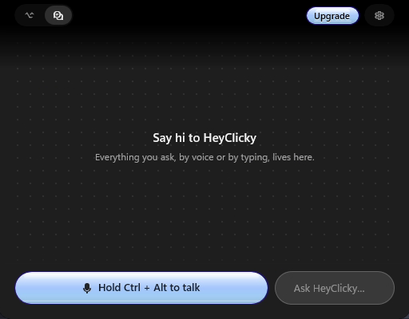

**Home tab**
- A greeting with the person's name ("Evening, Dylan.") and one line of
  live status ("1 job working").
- One large card for the newest finished piece of work, with a preview and
  one button ("Open page").
- Jobs still running sit as small cards **beside** the shape ("Working",
  the job's name, a progress line). You can see them without opening
  anything.
- Footer: **Invite & earn** (left) and **Apps +** (right).

**Chat tab**
- An empty state in one sentence ("Everything you ask, by voice or by
  typing, lives here").
- Two controls at the bottom: a big **Hold Ctrl + Alt to talk** button and
  an **Ask…** text box.

**Ours today:** Home (`ui/app_pages.py` `HomePage`) and the Tora page are
full-window pages. Home is busier and doesn't lead with the newest result.

**We take:** the greeting and status line, "newest result first" as one big
card, running jobs as cards beside the shape, the talk button and text box
side by side, and the footer.

---

## 3. Plans

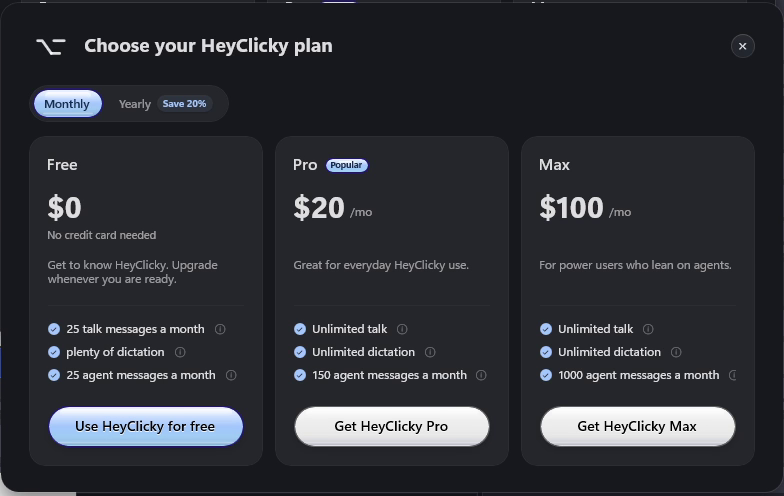

- Monthly / Yearly switch ("Save 20%").
- Three cards: name, price, one line of who it's for, three ticked
  allowances (each with an ⓘ), one button. The current plan's button is
  the highlighted one.

**Ours today:** `PlansTab` in the Settings window.
**We take:** the layout as a card over the app, opened from **Upgrade**
anywhere. Our plans, our prices, and credits instead of message counts.

---

## 4. Settings

One sidebar in three groups, with the version number at the bottom:

| Group | Pages |
|---|---|
| (top) | Account, General, Invite & Earn |
| **HEYCLICKY** (the assistant) | Voice, Microphone, Dictation, Shortcuts, Cursor |
| **WORK** (the agents) | Integrations, Agents, Routines |

Every page has the same pattern: a large title, a one-line grey
description, small CAPS section labels, and rounded cards of rows. Each row
has a title, a one-line grey explanation, and the control on the right.

### Account

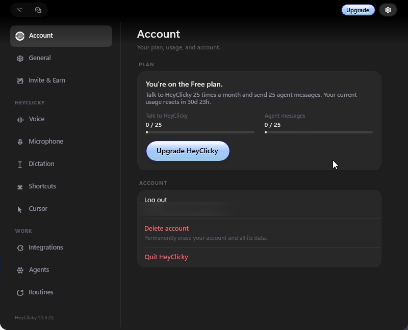

Plan card ("You're on the Free plan" + a sentence + one usage bar per
allowance + **Upgrade**), then Log out / Delete account / Quit.
**Ours:** split across `AccountTab`, `UsageTab` and `PlansTab`. **We take:**
all three in one page, laid out like this.

### General

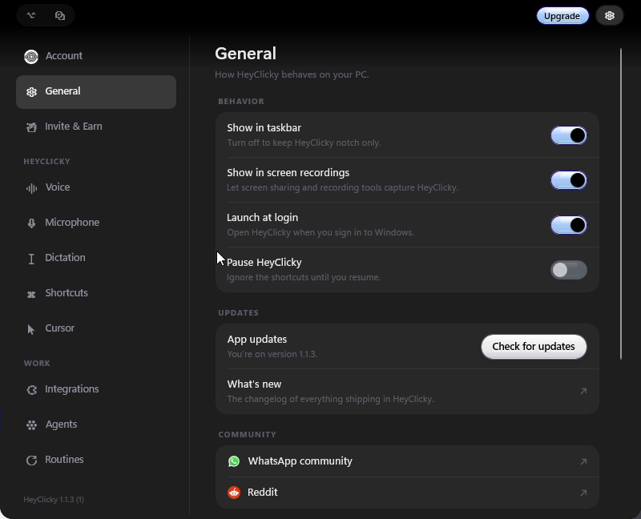 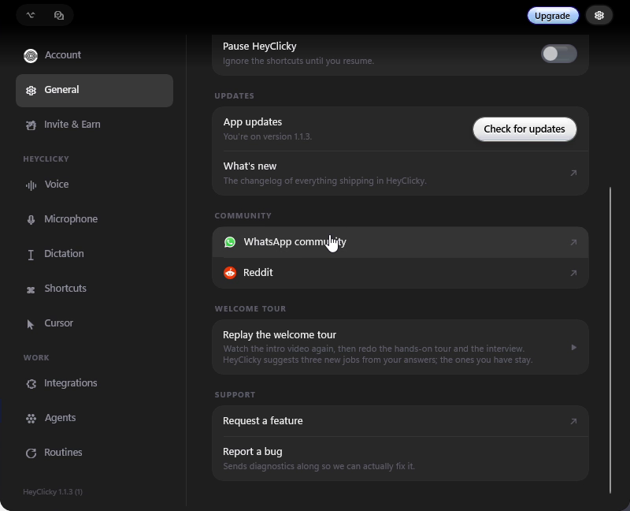

Behaviour (show in taskbar, show in screen recordings, launch at login,
pause), updates (check for updates, what's new), community, replay the
welcome tour, support (request a feature, report a bug with diagnostics).
**Ours:** spread across `GeneralTab`, `SystemTab` and `AdvancedTab`, and
the Help card.

### Invite & Earn

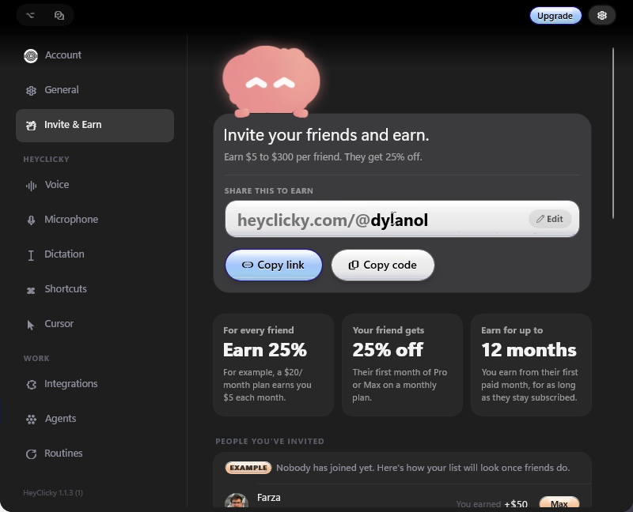 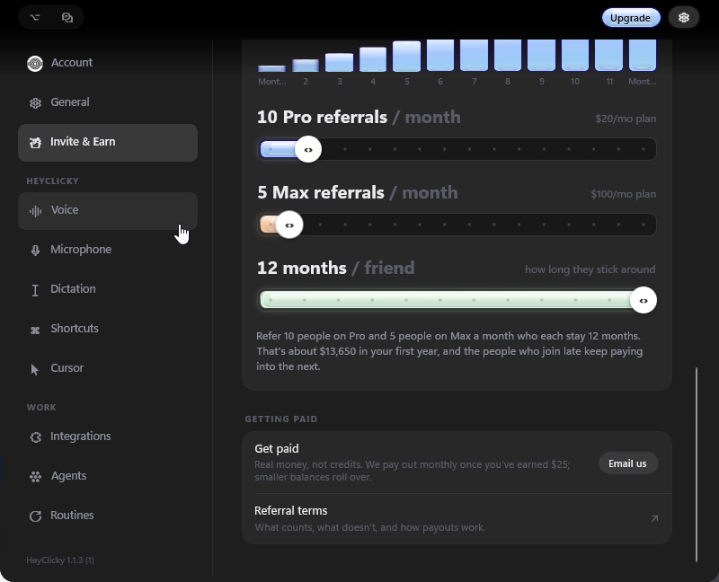

Your link with Copy link / Copy code, three facts in boxes, the people
you've invited (with an example row when empty), an earnings calculator
with sliders, and how you get paid.
**Ours:** a separate window (`ui/referral_window.py`). **We take:** it
becomes a settings page with this layout. The numbers are our referral
rules (`docs/REFERRALS.md`).

### Voice

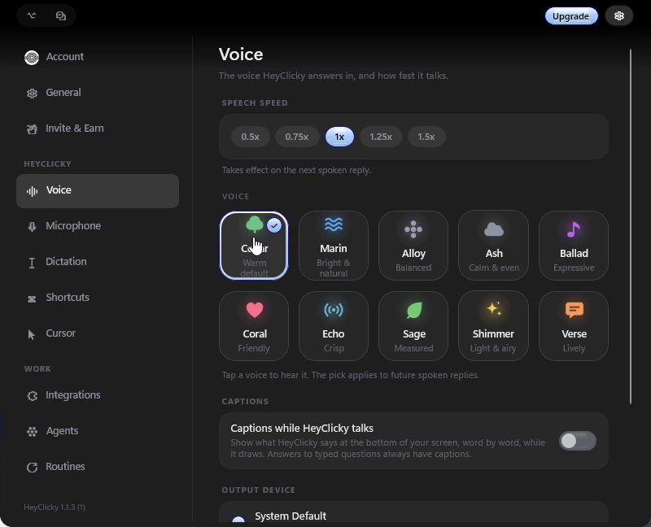 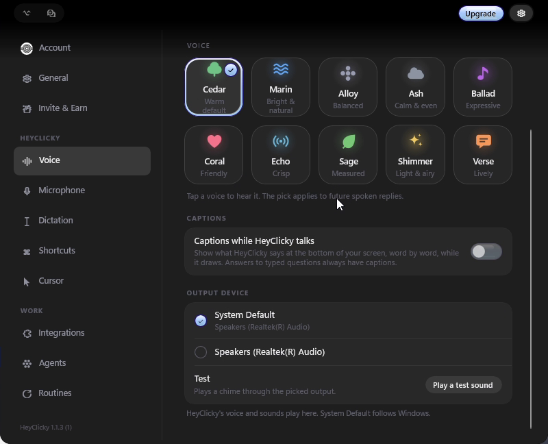

Speech speed chips (0.5×–1.5×), voices as a grid of tiles (icon, name,
two-word feel; tap to hear), captions on/off, output device with
**Play a test sound**.
**Ours:** the voice and captions are in `GeneralTab` / `settings_parts.py`.
We have no speed control or voice grid yet.

### Microphone

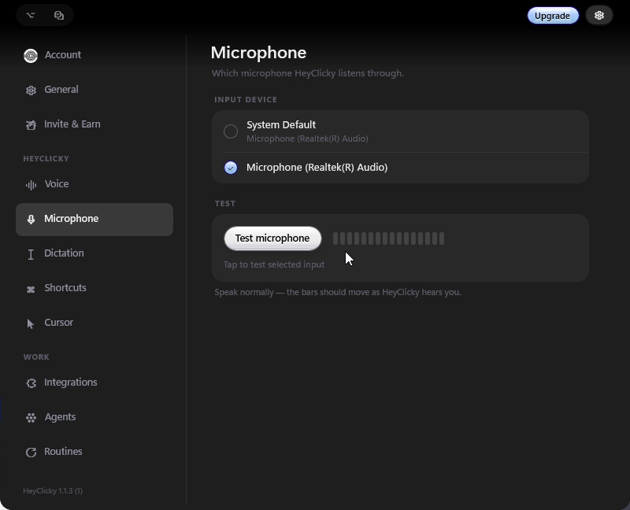

Input device as a radio list, **Test microphone** with live bars.
**Ours:** in `GeneralTab`.

### Dictation

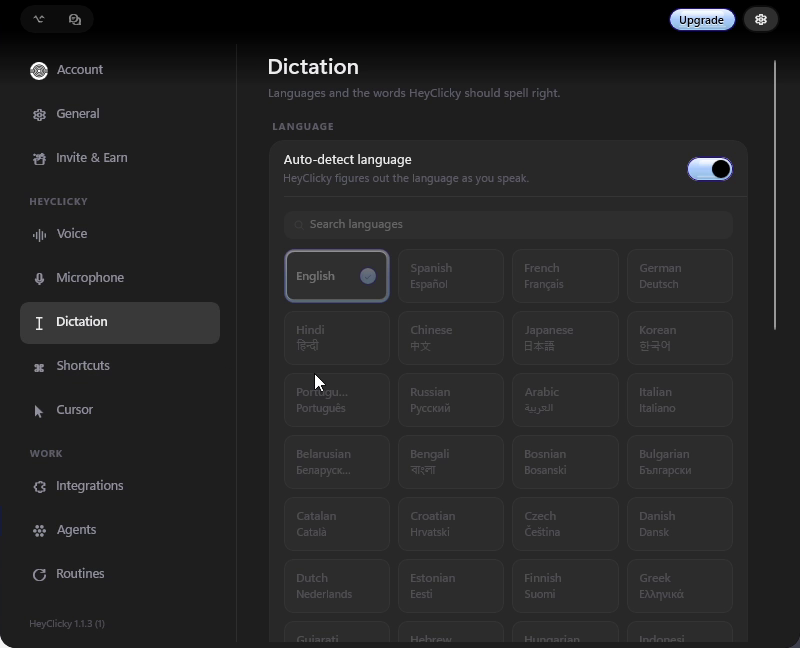 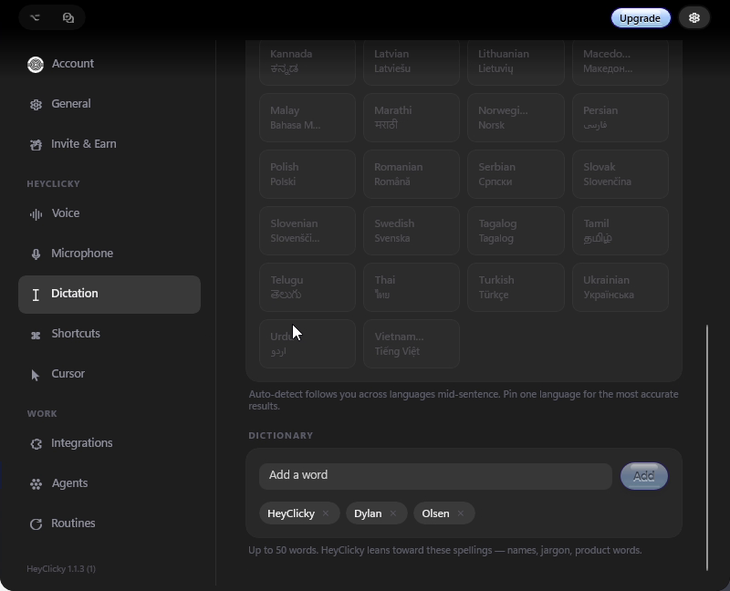

Auto-detect language, a searchable grid of languages, a dictionary of
words to spell right (chips you add and remove).
**Ours:** no page. The language is only a `.env` setting (`STT_LANGUAGE`),
and there's no dictionary. **New for us.**

### Shortcuts

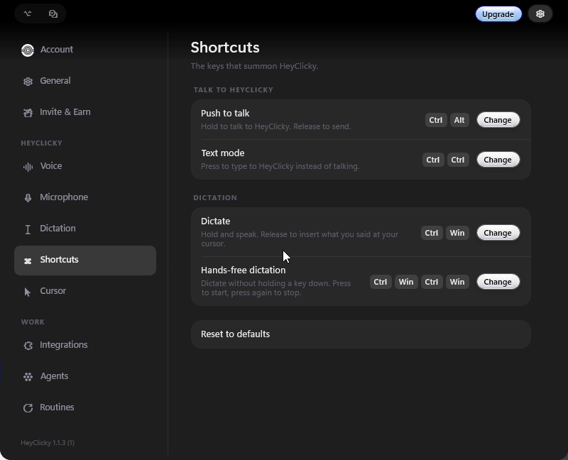

Push to talk, text mode, dictate, hands-free dictation. Each shows its keys
as key caps with **Change**. Reset to defaults at the bottom.
**Ours:** the hotkey row in `GeneralTab`.

### Cursor

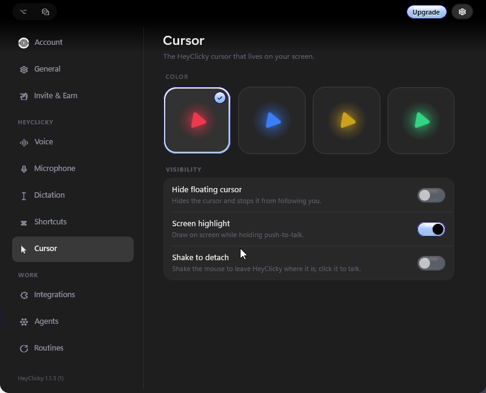

Colour as four big tiles, then visibility switches (hide the floating
cursor, screen highlight, shake to detach).
**Ours:** cursor colour and visibility are in `settings_parts.py` / Home.

### Integrations

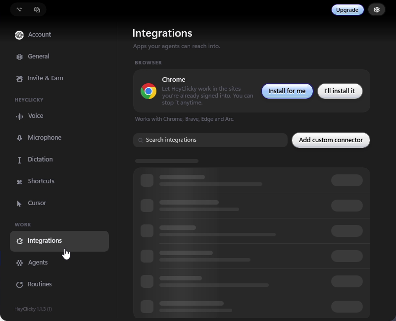

Browser (Chrome: **Install for me** / **I'll install it**), search, **Add
custom connector**, then the list of connectors.
**Ours:** connectors are in `settings_tabs.py`, and the browser companion
has no settings page.

### Agents

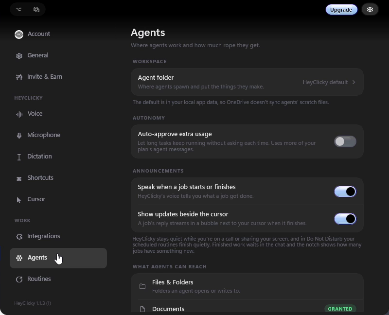 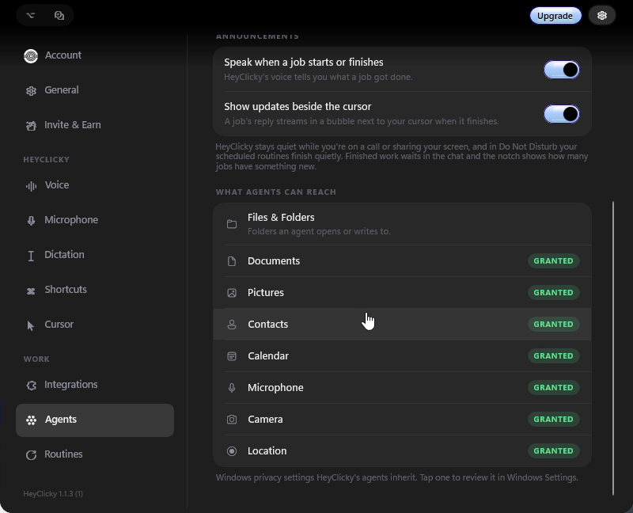

Agent folder, auto-approve extra usage, announcements (speak when a job
starts or finishes, show updates beside the cursor), and **what agents can
reach**: Files & Folders, Documents, Pictures, Contacts, Calendar,
Microphone, Camera, Location, each with a GRANTED badge.
**Ours:** `AgentsTab` and `PrivacyTab`. **We take:** the "what agents can
reach" list with badges. It's the clearest permission screen of any app
like this.

### Routines

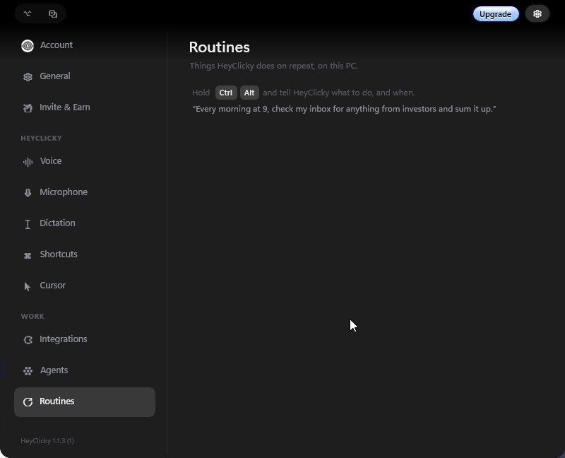

Empty state that teaches by example: *Hold Ctrl Alt and tell it what to
do, and when.* "Every morning at 9, check my inbox…"
**Ours:** routines exist (`agents/` + `agents_page.py`) with no page of
their own.

### Onboarding

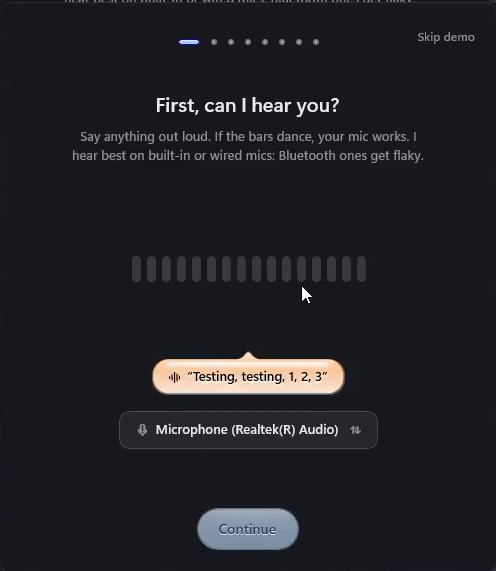

Step dots and **Skip demo** at the top, one question as the title ("First,
can I hear you?"), live mic bars, a speech bubble showing what it heard,
the device picker, and **Continue**.
**Ours:** `ui/setup_wizard.py` / `onboarding_parts.py`, already close.
Restyle to match.

---

## 5. What we keep that HeyClicky doesn't have

These stay, and get the same page pattern (title, grey line, CAPS
sections, cards of rows):

| Ours | Where it goes |
|---|---|
| **Insights** (`InsightsPage`) | A third tab in the open shape (Home · Chat · Insights) |
| **Journal** (`JournalPage`) | Reached from Insights ("everything asked") |
| **Agents board** (`agents_page.py`): running and finished jobs | Running jobs as cards beside the shape (like theirs); the full list behind **Apps +** |
| **Skills** (`skills_page.py`) | Settings → WORK → Skills |
| **Memory** (`MemoryTab`): what Tora knows about you | Settings → Account group, or WORK |
| **Code editors** (`CodeEditorsTab`: DevLink) | Settings → WORK → Code editors |
| **Privacy** (`PrivacyTab`): what Tora looks at and keeps | Settings → General group |

---

## 6. The new HeyTora at a glance

```
Closed            ( ● )                       pill at top-centre; glows while a job works

Open              [Home][Chat][Insights]          [Upgrade][⚙]
                  Evening, Dylan.  · 1 job working
                  ┌ newest result ─────────────┐   ▢ Working: <job>   ← beside the shape
                  └────────────────────────────┘
                  [Invite & earn]                [Jobs +]

Settings (⚙)      Account · General · Invite & Earn
                  TORA:  Voice · Microphone · Dictation · Shortcuts · Cursor
                  WORK:  Integrations · Agents · Routines · Skills · Code editors
                  ─ HeyTora 1.x.x
Upgrade           Plans card over the top
```

The tray icon stays (Windows users expect it), but its menu just opens the
shape. The separate app window, Settings window and referral window go
away.

---

## 7. Order of work (each step is usable on its own)

1. **The shape:** a frameless, always-on-top window at the top-centre
   that grows from pill → open → settings with the 250 ms motion. Its
   contents are the current pages at first.
2. **Settings** inside it: sidebar, the page pattern, and our tabs moved
   into the new grouping (§4, §5).
3. **Home, Chat, Insights** tabs, and the running-job cards beside the
   shape.
4. **Plans** card and **Invite & Earn** page.
5. **New pages:** Voice (speed, voice grid), Dictation (language,
   dictionary), Routines.
6. **Onboarding** restyle. Then delete the old window, the Settings
   window, and the referral window.

`docs/ui/DESIGN.md` gets rewritten before step 1. The Raycast / Wispr Flow
direction is replaced by this one.

---

## 8. Decided (28 Oct 2026)

- **Colours:** ours. HeyTora's accent blue and our colours in their layout.
- **Light and dark:** both stay, following Settings → Appearance.
- **Where the shape sits:** wherever the person drags it, as our pill does
  today. It grows from there towards the middle of the screen. The rules
  are in `DESIGN.md` §1–§2.
